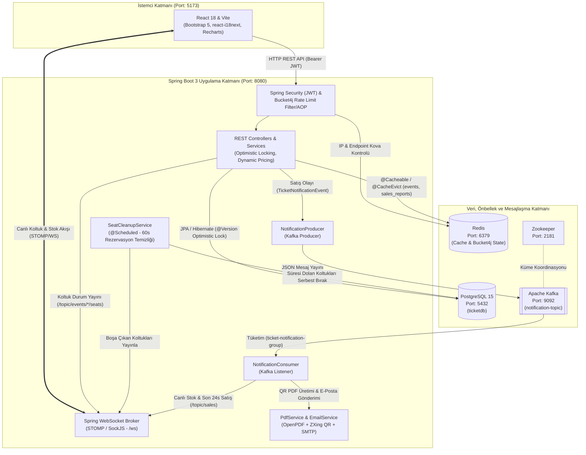

# TicketFlow — Yüksek Eşzamanlı Bilet Satış ve Etkinlik Yönetim Platformu


> [!TIP]
> **Modüler Mimari ve Commit Geçmişi:**  
> Bu depo, platformun tek komutla (`docker compose up --build`) çalıştırılabilir versiyonudur. Projenin geliştirme sürecini, detaylı commit geçmişlerini ve geliştirici dokümantasyonlarını incelemek için repolara göz atabilirsiniz:
>
> * **Backend API Reposu:** [ertugelbir-hub/biletsatisuygulamasi](https://github.com/ertugelbir-hub/biletsatisuygulamasi)
> * **Frontend Web İstemcisi Reposu:** [ertugelbir-hub/ticketapp-frontend](https://github.com/ertugelbir-hub/biletsatisuygulamasi-frontend)

---
## 1. Projenin Amacı ve Çözdüğü Problemler

Popüler konser, tiyatro ve diğer etkinliklerde bilet satışları açıldığı anda binlerce kullanıcı aynı milisaniyede aynı koltukları satın almaya çalışır. Geleneksel sistemlerde bu durum **Race Condition (Yarış Durumu)**, **Çifte Bilet Satışı (Double-Booking)**, veritabanı kilitlenmeleri ve ana sunucu thread'lerinin (PDF oluşturma ve e-posta gönderimi gibi ağır işlemler nedeniyle) tıkanmasına yol açar.

**TicketFlow**, bu sorunları çözmek için tasarlanmış gerçek zamanlı bir biletleme platformudur:

* **Veri Tutarlılığı ve Race Condition Önleme:** JPA `@Version` tabanlı **Optimistic Locking (İyimser Kilitleme)** ve otomatik yeniden deneme (**Retry**) mekanizması sayesinde aynı koltuğun birden fazla kişiye satılması engellenir.
* **Gerçek Zamanlı Koltuk Kilitleme (Seat Hold):** Bir kullanıcı koltuğa tıkladığı anda koltuk 10 dakikalığına rezerve olur ve **WebSocket (STOMP/SockJS)** üzerinden tüm bağlı kullanıcıların ekranında anında **Sarı (Rezerve)** durumuna geçer.
* **Asenkron Yük Devri (Event-Driven Architecture):** Satın alma işlemi tamamlandığında kullanıcı bekletilmez; QR kodlu PDF bilet üretimi, e-posta gönderimi ve canlı istatistik yayınları **Apache Kafka** yardımıyla arka planda eşzamanlı olarak işlenir.
* **Dağıtık Hız Sınırlandırma ve Önbellek:** **Redis** ve **Bucket4j** entegrasyonu ile API uç noktaları aşırı yüklenmeye ve Brute-Force saldırılarına karşı korunur.

---

## 2. Sistem Mimarisi

Aşağıdaki mimari şema; React istemcisinden başlayarak Spring Boot uygulama katmanı, PostgreSQL veritabanı, Redis önbellek/hız sınırlayıcı ve Apache Kafka mesaj kuyruğu arasındaki veri akışını göstermektedir:



---

## 3. Genel Özellikler

* **Optimistic Locking & Concurrency Control:** `Event` ve `Seat` tablolarında aynı anda yapılan satın alma işlemlerinde çakışmalarını yakalamak için versiyon kontrolü yapılıyor, 3 kez otomatik yeniden deneme (`MAX_RETRY = 3`) ve çakışma halinde `409 Conflict` yönetimi.
* **WebSocket ile Canlı Koltuk Haritası:** Sahne önü ve yan tribünlerden oluşan Amfi koltuk düzeninde anlık koltuk seçimi, 10 dakikalık geri sayım sayacı ve periyodik zamanlayıcı (`SeatCleanupService`) ile süresi dolan koltukların otomatik boşa düşürülmesi.
* **QR Kodlu Dijital PDF Bilet:** **ZXing** kütüphanesi ile bilet/kullanıcı verilerini içeren karekod üretimi ve **OpenPDF** ile A5 formatında indirilebilir ve e-postayla gönderilebilen şekilde pddf biletler oluşturma.
* **Redis Önbellekleme & Bucket4j Rate Limiting:** IP bazlı global filtre (10 saniyede 40 istek) ve AOP tabanlı metot kilidi (`/api/auth/login` için dakikada 3 istek) ile dinamik `retryAfter` geri sayım desteği.
* **Dinamik Fiyatlandırma & Kupon Sistemi:** Etkinlik doluluk oranı **%80**'i aşarsa bilet fiyatlarında otomatik olarak **%10** zam yapan algoritma ve `YILBASI` kupon kodu ile %20 indirim desteği.
* **Gelişmiş Yönetici Paneli & Raporlama:** **Recharts** ile görsel satış grafikleri, tarih aralığına göre ciro filtreleme, Excel uyumlu **CSV (UTF-8 BOM)** ve **PDF** formatında birleşik satış raporu dışa aktarma.
* **Çoklu Dil Desteği (i18n):** `react-i18next` altyapısı ile **Türkçe (TR)**, **İngilizce (EN)** ve **Almanca (DE)** dilleri arasında anlık geçiş.

---

## 4. Proje'nin Yapısı

```text
TicketFlow/
├── docker-compose.yml          # Tüm altyapı ve uygulama servislerinin merkezi yönetimi
├── README.md                   # Proje geneli bilgilendirilmesi
├── ticket-app/                 # Spring Boot 3 & Java 21 Backend modülü
└── ticketapp-frontend/         # React 18 & Vite Frontend modülü
```

---

## 5. Hızlı Başlangıç (Docker Compose)

Sisteminizde **Docker** ve **Docker Compose** yüklüyse hiçbir ek kurulum yapmadan tüm projeyi ve hizmetleri tek komutla çalıştırabilirsiniz.

Terminalde kök dizine gidin ve aşağıdaki komutu çalıştırın:

```bash
docker compose up --build
```

Servisleri durdurmak için:

```bash
docker compose down
```

---

## 6. Servis Portları ve Erişim Tablosu

| Servis | Port | Erişim Adresi / Bağlantı Bilgisi | Açıklama |
| :--- | :--- | :--- | :--- |
| **Frontend (React)** | `5173` | [http://localhost:5173](http://localhost:5173) | Kullanıcı ve Yönetici Web Arayüzü |
| **Backend API** | `8080` | [http://localhost:8080](http://localhost:8080) | Spring Boot 3 REST API & WebSocket Sunucusu |
| **Swagger UI** | `8080` | [http://localhost:8080/swagger-ui.html](http://localhost:8080/swagger-ui.html) | İnteraktif OpenAPI 3.0 Dokümantasyonu |
| **PostgreSQL 15** | `5432` | `localhost:5432` (DB: `ticketdb`, User: `postgres`, Pass: `password123`) | İlişkisel Ana Veritabanı |
| **Redis** | `6379` | `localhost:6379` | Dağıtık Önbellek & Bucket4j Rate Limiting |
| **Apache Kafka** | `9092` | `localhost:9092` (Docker içi: `kafka:29092`) | Eşzamanlı Bildirim & Mesaj Kuyruğu |

---

## 7. Hazır Test Kullanıcıları

`SeedConfig` sınıfı, uygulama başlatıldığında veritabanında otomatik olarak aşağıdaki test kullanıcılarını tanımlar:

| Rol | Kullanıcı Adı | Şifre | Yetki Kapsamı |
| :--- | :--- | :--- | :--- |
| **Yönetici (ADMIN)** | `admin` | `admin123` | Etkinlik ekleme/düzenleme/silme, satış/ciro raporları (PDF/CSV), tüm biletleri ve kullanıcıları yönetme |
| **Standart Kullanıcı (USER)** | `ayse` | `ayse123` | Etkinlik arama, canlı koltuk seçimi ve rezervasyon, bilet satın alma/iptal, QR PDF bilet indirme, favoriler |